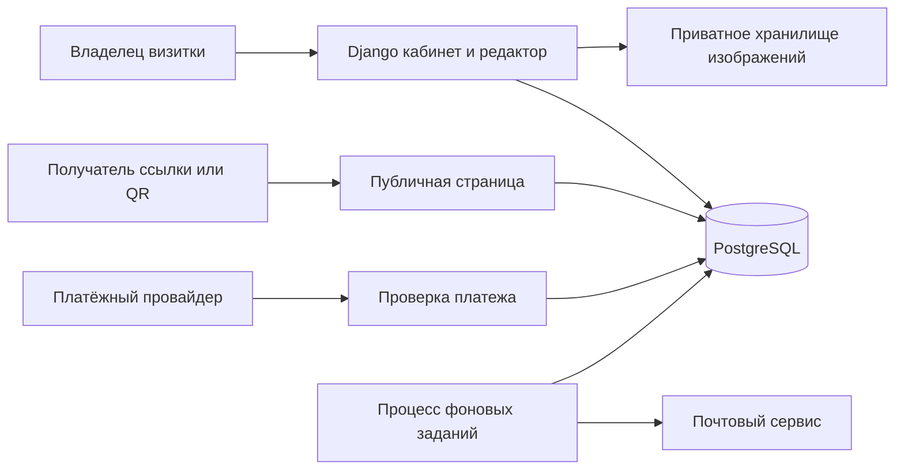

# Архитектура и технические контракты

Реализован клиентский домен по модели SPCh: `domains/`, DomainBinding с выбранной визиткой и пространством, хеш TXT-токена, DNS/HTTPS-статусы, очередь с поколением и арендой задания, DomainAudit и heartbeat обработчика. Владелец добавляет домен из кабинета, серверный worker Nginx/Certbot из management command выпускает и продлевает только сертификаты myQR. Смена назначения внутри того же пространства сохраняет DNS и сертификат; отключение меняет TXT-токен и отменяет старые задания. Подробности эксплуатации — `ops/DOMAINS.md`.

Роутинг не использует wildcard ALLOWED_HOSTS: основные адреса валидируются штатно, для точного совпадения активной привязки middleware валидирует исходный Host, устанавливает проверенный get_host только на этот запрос и отдельный публичный URLconf. Публичные обработчики получают workspace из проверенной привязки и ограничивают HTML, vCard, QR, изображения и QR/NFC-переходы. Кабинет и авторизация на клиентском домене отсутствуют. Подтверждение DNS старше двух суток или истёкший сертификат закрывают маршрут, даже если worker остановлен. Изменение основного домена платформы через админку пока не реализовано; прежние адреса сохраняются в конфигурации.

QR на месте фото выдаётся через `/c/{public_id}/qr.png` после общей проверки публичного доступа, содержит стабильный адрес электронной визитки, отдаётся без кэширования. Владелец использует существующий приватный маршрут QR в предпросмотре.

PhysicalCard: UUID, случайный неизменяемый public_id, workspace, назначенная Card или NULL, название, enabled, административный blocked, version и даты. `/p/{public_id}` выполняет временный 302 без кэша на относительный `/c/{card.public_id}` только после проверки принадлежности одной рабочей области и публичного доступа. Входящий Host не используется для генерации QR. Постоянная ссылка берётся из PUBLIC_BASE_URL.

Владелец управляет носителями через `/app/physical-cards`, изменения — POST с CSRF и проверкой workspace; создание и перепривязка блокируют пространство и запись носителя. Версия защищает от перезаписи другой вкладкой; PhysicalCardEvent сохраняет автора, действие и назначение. Отключённые носители сохраняют public_id. При несовпадении пространств, блокировке, удалении/скрытии электронной визитки или истечении Pro переход возвращает 404.

Запись NFC выполняется пользователем в поддерживаемом браузере через Web NFC / NDEF URL по явному нажатию и подтверждению замены прежней записи. Есть отмена, таймаут и обработка отказа. При неподдерживаемом API предлагается копирование ссылки для отдельного приложения. Запись loopback URL отключена. NFC не служит доказательством владения аккаунтом, URL метки не содержит сессию или секрет. UID чипа не используется.

Третье назначение изображений — `target=header`, поле содержимого `headerAssetId`. Полный набор: `backgroundAssetId`, `avatarAssetId`, `headerAssetId`. Все три UUID проверяются на принадлежность пространству, сохраняются формой независимо и выдаются только из текущего черновика владельцу или текущего опубликованного снимка посетителю. Квоты, декодирование и обработка изображений общие. Старые визитки без шапки сохраняют прежнее оформление.

Дополнение к содержимому v1: необязательный объект `socials` с ключами `instagram`, `threads`, `telegram`, `vk`, `ok`, `max`, `avito`; существующее поле `website` используется для кнопки «Сайт». Все адреса проходят ту же серверную проверку HTTP/HTTPS, длины, учётных данных и управляющих символов, что и остальные ссылки. Отсутствующие поля не меняют совместимость старых визиток. Логотипы хранятся в статических ресурсах проекта; произвольные SVG от пользователей не принимаются.

`backgroundAssetId` — необязательный UUID приватного Asset, принадлежащего тому же пространству. Загрузка `/app/assets` принимает назначение `target=avatar|background`; при отсутствии назначения сохраняется прежнее поведение фото профиля. Фон использует общие ограничения декодирования и квоты изображений. Маршруты изображений допускают только UUID фото профиля или фона из текущего черновика для владельца либо текущего опубликованного снимка для посетителя. Удаление фона из черновика не меняет опубликованный снимок до публикации. Постоянный QR не меняется.

## Выбор стека

Для разработки одним владельцем с Codex предлагается модульный монолит: Python 3.14, Django 5.2 LTS с актуальным исправлением безопасности, PostgreSQL 17, серверные шаблоны, обычные CSS и JavaScript для предпросмотра. Версии библиотек фиксируются lock-файлом при создании приложения. Django 5.2 поддерживает Python 3.14 начиная с 5.2.8 согласно [release notes](https://docs.djangoproject.com/en/5.2/releases/5.2/); срок поддержки ветки проверен по [таблице Django](https://www.djangoproject.com/download/).

Django даёт общую основу для аккаунтов, форм, миграций и административного интерфейса. Шаблоны экономят время на отдельном клиентском API. Меры защиты строятся с учётом [официальных рекомендаций Django](https://docs.djangoproject.com/en/5.2/topics/security/).

На первом этапе: приложение, PostgreSQL, приватное S3-совместимое хранилище изображений в выбранном российском регионе, SMTP-провайдер и обратный прокси с HTTPS. Фоновые письма и очистку выполняет отдельный процесс из того же проекта через таблицу заданий. Redis и Celery вводятся только при измеренной необходимости. Локально почта выводится в консоль; реальные внешние сервисы для первой вертикали не нужны.

## Потоки данных

Каждый запрос владельца получает рабочее пространство из сессии и членства, а не доверяет присланному `workspace_id`. Первый выпуск поддерживает одного владельца пространства; командные роли пока не выдаются.

## Модель данных

| Сущность | Основные поля и инварианты |
| --- | --- |
| User | UUID, нормализованный уникальный email, хеш пароля, email_verified_at, статус; модель создаётся до первой миграции |
| Workspace | UUID, owner_id, название; отдельный объект для будущих команд |
| Membership | user_id, workspace_id, role; уникальна пара; в MVP только owner |
| Card | UUID, workspace_id, public_id, draft JSON, draft_version, published_revision_id, status, timestamps |
| CardRevision | UUID, card_id, schema_version, content JSON, created_at; опубликованный снимок неизменяем |
| Asset | UUID, workspace_id, object_key, тип, байты, ширина, высота, статус проверки; ссылки только внутри пространства |
| Subscription | workspace_id, plan=pro, paid_until, status=pending/active/expired; одна текущая запись на пространство; бесплатного тарифа нет |
| DomainBinding | UUID, hostname_ascii unique, scope=platform/workspace, workspace_id, root_card_id, verification_token_hash, dns_status, tls_status, status, verified_at, last_checked_at; клиентский домен связан ровно с одним пространством |
| Payment | UUID, workspace_id, provider_payment_id unique, amount_kopecks, currency, period, status, idempotency_key unique |
| PaymentEvent | provider, payment_id, event_type, обработка; уникальный ключ для повторных уведомлений |
| DailyMetric | card_id, day, event_type, count; уникальна тройка, без персональных профилей посетителей |
| Report | card_id, категория, текст, статус; лимиты подачи и журнал разбора |
| AuditLog | actor_id, workspace_id, action, object_id, timestamp; без паролей и токенов |
| ConsentRecord | user_id, вид, версия текста, timestamp; маркетинг отдельно и добровольно |
| OutboxJob | тип, ссылка на объект, run_after, attempts, lock_until, status; полезная нагрузка без секретов |

Card.public_id — случайная строка не менее 128 бит энтропии, уникальная, неизменяемая, не переиспользуется после удаления. Индексы: Card(workspace_id, updated_at), Card(public_id) unique, Payment(provider_payment_id) unique, OutboxJob(status, run_after). UUID не заменяет проверку прав.

Черновик проверяется по `card.schema.json`. JSON хранит только содержимое страницы; статус, владелец, тариф и права публикации — отдельные серверные поля. Дополнительно сервер проверяет корректность URL, телефона и email, владение изображением и лимиты тарифа. Пользовательский текст выводится с экранированием.

## Публикация и постоянный QR

Запрос публикации в транзакции блокирует запись пространства для проверки лимитов, затем визитку, сверяет draft_version, проверяет email, активную оплату и блокировку. Создаёт CardRevision и переключает published_revision_id. Конкурирующее изменение возвращает 409, не перетирает правки. Снятие с публикации закрывает страницу и vCard; блокировка администратором имеет приоритет над публикацией владельца.

QR содержит URL `/c/{public_id}`, а не телефон или весь vCard. URL остаётся тем же при изменении имени, шаблона и контактов. Изображение QR доступно владельцу; публичная страница и vCard читают только опубликованный снимок. В первой версии публичный HTML и vCard отправляются с `Cache-Control: no-store`, чтобы снятие с публикации не оставляло доступный CDN-кэш. Ранее скачанные посетителем данные отозвать невозможно.

## Маршруты первого выпуска

Это контракт серверных страниц и действий; JSON API для мобильных приложений пока не нужен.

| Метод и путь | Доступ и результат |
| --- | --- |
| GET / | Главная |
| GET /pricing | Тарифы |
| GET и POST /accounts/register | Регистрация; POST с CSRF и ограничением частоты |
| GET и POST /accounts/login | Сессия; одинаковая ошибка для неизвестной почты и неверного пароля |
| POST /accounts/logout | Завершение сессии с CSRF |
| GET и POST /accounts/verify/{token} | GET показывает подтверждение; POST расходует одноразовый токен |
| GET и POST /accounts/password-reset | Нейтральный ответ; одноразовое восстановление |
| GET /app/cards | Только свои визитки |
| POST /app/cards | Создать черновик в рамках тарифа |
| GET и POST /app/cards/{uuid}/edit | Предпросмотр и сохранение с draft_version |
| POST /app/cards/{uuid}/publish | Публикация; 409 при конфликте, 422 при ошибке данных |
| POST /app/cards/{uuid}/unpublish | Снятие с публикации |
| POST /app/cards/{uuid}/delete | Удаление после явного действия владельца |
| GET /app/cards/{uuid}/qr.png | QR своей визитки |
| POST /app/assets | Проверить и принять своё изображение |
| GET /c/{public_id} | Публичный снимок; 404 для неизвестной, скрытой или заблокированной страницы |
| GET /c/{public_id}/contact.vcf | Только публичные контактные поля; 404 при закрытой странице |
| POST /c/{public_id}/report | Жалоба с ограничением частоты |
| POST /billing/checkout | Авторизованный запрос; сервер выбирает цену по коду тарифа |
| POST /billing/webhook | Без браузерной сессии; проверка у провайдера, идемпотентность |
| GET /health/live и /health/ready | Минимальный статус процесса и доступности БД, без конфигурации |

Успешные POST форм возвращают 303 на страницу результата. Чужой объект возвращает 404. Авторизованные POST требуют CSRF, webhook имеет отдельный обработчик. Страница редактора показывает ошибки полей и сохраняет введённые значения при 422.

## Оплата

Предварительно — ЮKassa, окончательный выбор зависит от договора владельца. Сумма хранится целым числом копеек, валюта RUB; браузер не передаёт доверенную сумму. [Документация уведомлений провайдера](https://yookassa.ru/developers/using-api/webhooks) служит основой интеграции.

Возврат браузера со страницы оплаты только показывает статус. Webhook инициирует получение платежа через API провайдера; сверяются идентификатор, статус, сумма, валюта и связь с локальным заказом. Активация периода и запись обработанного события выполняются атомарно. Повторное уведомление не продлевает период повторно. При недоступности проверки задача повторяется, доступ пока не включается. Периодическая сверка восстанавливает пропущенные уведомления. До подтверждения успешного платежа новая подписка не активируется; при первом платеже доступен только закрытый черновик.

Рекуррентные платежи, сохранение платёжного метода и автопродление не входят в MVP. Отмена, истечение, возврат и частичный возврат имеют отдельные состояния; денежные записи не удаляются вместе с визиткой. Обязательные сроки хранения и правила возврата определяются перед платным запуском с учётом формы бизнеса.

## Защита и эксплуатация

Вход — защищённые HttpOnly cookie с Secure и SameSite, CSRF на изменениях, HTTPS. Доступ к админке — отдельная роль и второй фактор до публичного запуска. Письма подтверждения и восстановления используют ограниченные по сроку одноразовые токены, в БД хранятся их хеши. Лимиты регистрации, писем, входа и жалоб защищают открытую регистрацию от массовых запросов.

На старте разрешены JPEG, PNG и WebP до 5 МБ и 20 мегапикселей: фактическое декодирование, перекодирование и удаление EXIF. SVG, HTML и пользовательские файлы не принимаются. Сервер не скачивает изображения по URL. Ссылки допускают только https/http; специальные кнопки tel/mailto строятся из валидированных полей. Объектные ключи и серверные пути не принимаются от клиента.

На общих публичных страницах не сохраняются исходные IP в аналитике. Для ограничения злоупотреблений допустимы короткоживущие технические идентификаторы по отдельной политике хранения. Сырые события аналитики не нужны: агрегаты по дням, очистка старше 90 дней. Логи не содержат контактов, cookie, токенов и тел webhook целиком.

Удаление аккаунта сразу снимает публикации и ставит очистку активных данных и изображений в очередь с целевым сроком до 30 дней; обязательные платёжные записи обрабатываются отдельно. Бэкапы имеют определённый срок жизни, восстановление повторно применяет журнал удалений. Политика сроков должна совпасть с опубликованными документами.

До публичного запуска: определить состав собираемых данных, роли сервиса и пользователей, подготовить оферту, политику обработки и необходимые согласия, проверить применимые требования к размещению данных и оплате с профильным специалистом. Российский регион хранения — проектное требование; само по себе размещение не доказывает соответствие законодательству.

Цели пилота, подлежащие нагрузочной проверке: 10 000 аккаунтов, 30 000 визиток, 50 запросов/сек к публичным страницам; p95 до 800 мс на согласованном сервере без учёта сети посетителя. Ежедневный зашифрованный бэкап БД, отдельное хранение резервной копии, проверка восстановления ежемесячно; RPO до 24 часов, RTO до 4 часов. Это цели, а не измеренные характеристики. Безлимитный рост не обещается: масштабирование — дополнительные процессы приложения, затем оптимизация БД и фоновой очереди по метрикам.

## Структура будущего приложения

`config/`, `accounts/`, `workspaces/`, `cards/`, `billing/`, `moderation/`, `metrics/`, `domains/`, `jobs/`, `templates/`, `static/`, `tests/`, `ops/`. Секреты только в переменных окружения, `.env` исключён из Git, пример конфигурации не содержит ключей. Разработка, тестовый и рабочий контуры имеют разные базы, хранилища и ключи оплаты.

## Проверка оплаченного доступа

Каждый публичный запрос HTML, vCard и изображений проверяет paid_until по серверному времени, блокировку и статус публикации. Проверка действует на всех доменах и не зависит от своевременного выполнения фоновой задачи. Скрытая по окончании оплаты визитка возвращает нейтральный 404 без контактов. Изображения выдаются через контролируемый маршрут, а не постоянный публичный URL хранилища. После продления открываются только страницы, которые были опубликованы и не заблокированы. Серверные квоты действуют при параллельных запросах; до первой оплаты — один закрытый черновик, после оплаты — до трёх визиток.

## Управление доменами

Владелец создаёт привязку из кабинета, рабочее пространство определяется из его членства. Назначенная корневая визитка должна принадлежать этому пространству. Уникальность нормализованного hostname глобальна; доступен один клиентский домен на пространство. Действия фиксируются в DomainAudit. Администратор может заблокировать домен; владелец не может обойти блокировку отключением или удалением привязки. Основные домены и старые алиасы платформы перечисляются в конфигурации для сохранения ранее выданных QR.

Принимается только имя публичного домена: без схемы, порта, пути, wildcard и IP. Кириллические домены нормализуются в IDNA; интерфейс показывает исходное и ASCII-имя. Генерируется одноразовый случайный DNS TXT токен для `_cards-verify.<hostname>`, отдельно показывается CNAME на выделенный ingress либо A/AAAA на сервер для корневого домена. Точный тип и значение записи зависят от развёртывания. CNAME не сочетается с A/AAAA на том же имени. www и корневой домен — отдельные привязки, если нужны оба.

Состояния: pending_dns → verified → queued → issuing → active; отдельно error и disabled, административная блокировка хранится отдельным флагом. Активация возможна только после совпадения TXT, назначения A на ingress и готовности сертификата. Отключение меняет nonce TXT и поколение задания; повторное подключение и перенос домена требуют нового подтверждения владения. После истечения Pro контакты закрываются при каждом запросе. DNS/TLS периодически проверяются; устаревшая проверка DNS или истёкший сертификат закрывают маршрут. Удаление привязки снимает маршрутизацию.

Текущая реализация использует Nginx/Certbot по примеру SPCh. Владелец запрашивает сертификат через очередь; отдельный серверный management command создаёт только конфигурации myQR и именованные сертификаты, выполняет nginx -t и сохраняет прежний файл для отката. Домен не подставляется в shell-команду; используются массивы аргументов. Чужие virtual host, включая SPCh, не перезаписываются. Произвольный Host никогда не инициирует выпуск сертификата. Caddy может рассматриваться как отдельная альтернатива ingress, но одновременно с текущим обработчиком не устанавливается.

Основные домены и клиентские домены имеют разные маршруты. На клиентском домене доступны только публичные визитки назначенного пространства, vCard, необходимые изображения и жалобы. Чужой public_id возвращает 404. Вход, админка, оплата и восстановление пароля обслуживаются только основным доменом. Cookie авторизации ограничены конкретным хостом. Ссылки в письмах строятся из настроенного основного адреса, а не присланного Host.

Входящий Host проверяется на прокси и в приложении по разрешённым привязкам; произвольный wildcard ALLOWED_HOSTS без собственной валидации недопустим. Требования Django описаны в [ALLOWED_HOSTS](https://docs.djangoproject.com/en/5.2/ref/settings/#allowed-hosts). Периодическая проверка DNS и сертификатов переводит проблемный домен в ошибку или приостановку и уведомляет администратора. Сертификаты и их ключи хранятся вне пользовательских данных, с ограниченным доступом.

Админские действия: создание и изменение привязки, повторная проверка, активация, отключение, выбор основного домена платформы. Все изменяющие запросы — POST с CSRF. При смене основного домена сначала подтверждаются DNS и HTTPS нового, затем переключается канонический адрес; старый сохраняет HTTPS и публичные пути для QR. Сессии между разными доменами автоматически не переносятся. Базовый адрес оплаты и callback меняется отдельно согласованной настройкой провайдера.
